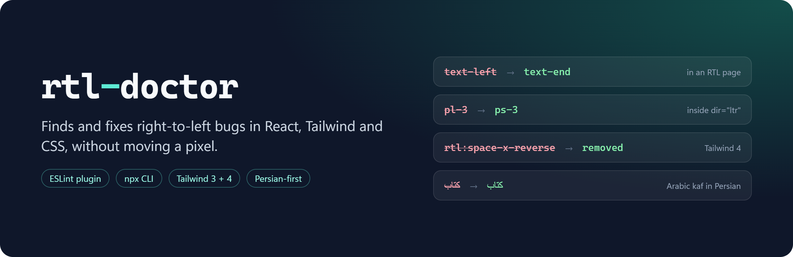
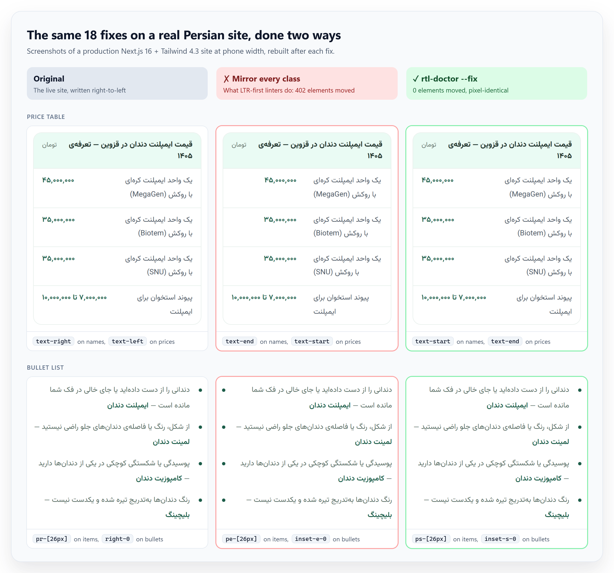
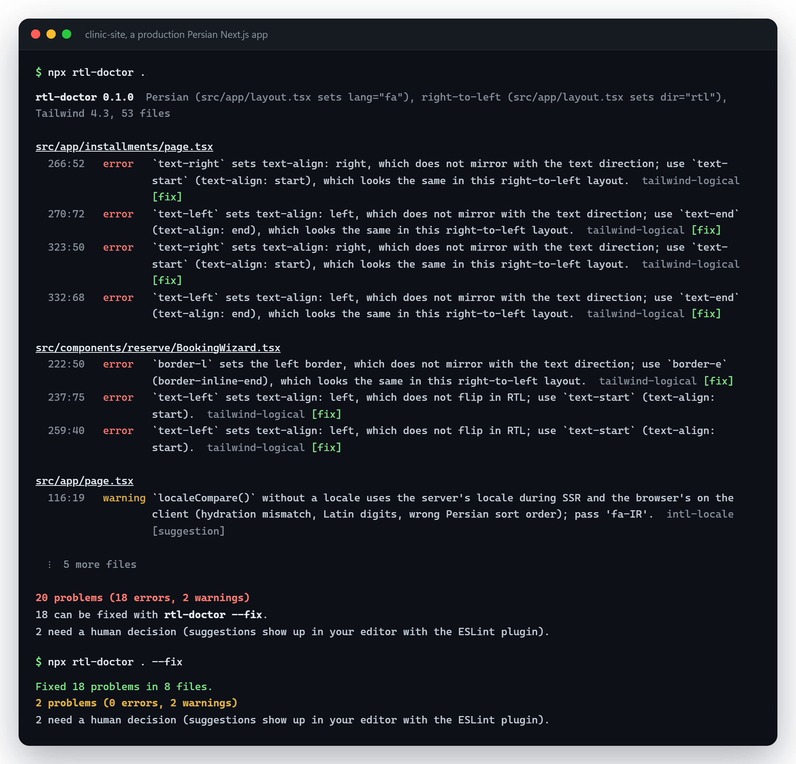

<p align="center">
  
</p>

<p align="center">
  <a href="https://www.npmjs.com/package/rtl-doctor"></a>
  <a href="https://github.com/Amirjaz/rtl-doctor/actions/workflows/ci.yml"></a>
  
  <a href="LICENSE"></a>
  <a href="#فارسی"></a>
</p>

**rtl-doctor** finds the right-to-left bugs in React, Tailwind and CSS code, and fixes the
ones that have a single correct answer. It is an ESLint plugin and a zero-config CLI:

```bash
npx rtl-doctor .          # report, exit code 1 if anything is wrong
npx rtl-doctor . --fix    # apply the safe fixes
```

## See it on a real site



These are screenshots of a production Persian site (Next.js 16, Tailwind 4.3), rebuilt
after each fix. The usual approach, mirroring every physical class, moves the prices up
against the service names and sends the bullets to the far edge (middle). rtl-doctor picks
the logical side that keeps today's look (right): its screenshots are byte-for-byte equal
to the originals. Across 9 pages at two screen widths, **0 of 6,058** elements moved,
against **402** for the mirror mapping. [How this was measured](docs/VERIFICATION.md).



The report it printed. `BookingWizard.tsx` shows both sides of the rule: `border-l` on
the right-to-left page becomes `border-e`, while `text-left` inside the `dir="ltr"` phone
input becomes `text-start`.

## Why it exists

- **Knows which way your app renders.** Fixes keep today's look: in an app with
  `dir="rtl"`, `pl-4` becomes `pe-4`, because there the left side is the inline end. In an
  LTR app, or inside a `dir="ltr"` island such as a phone input, the same class becomes
  `ps-4`. Mirror-everything tools get one of these two cases wrong.
- **Knows your Tailwind version.** Tailwind 4 writes `space-x-*` with logical properties, so
  `rtl:space-x-reverse` now *breaks* spacing; in Tailwind 3 its absence breaks it. And
  `left-*` fixes to `start-*` before 4.2, `inset-s-*` from 4.2 on. Checked against real
  Tailwind 3.4 and 4.3 in the test suite, not from a hand-written table.
- **Quiet on purpose.** Symmetric pairs (`pl-4 pr-4`), the `left-1/2 -translate-x-1/2`
  centring idiom, `rtl:` variants, `[dir]` selectors, `@keyframes` and RTLCSS
  `/* rtl:ignore */` comments are not reported. Projects that flip CSS with `rtlcss` get
  their layout checks switched off automatically.
- **Persian text too.** Arabic `ي` and `ك` in Persian strings (a user who types `کتاب`
  never finds `كتاب`), Arabic-Indic digits, and `toLocaleString()` without a locale.
- **ESLint plugin and CLI in one package.** Same rules in your editor, in CI, and in a
  one-off `npx` run. No config needed: it reads `lang` and `dir` from your app.

## Before and after

A Persian Next.js app (`<html lang="fa" dir="rtl">`) with a phone input that renders
left to right:

```diff
  <main className="container mx-auto pl-6 pr-6">
-   <header className="flex items-center space-x-4 rtl:space-x-reverse">
+   <header className="flex items-center space-x-4">
-     <h1 className="text-left text-2xl ml-2">فروشگاه كتاب</h1>
+     <h1 className="text-end text-2xl me-2">فروشگاه کتاب</h1>
    </header>
-   <p className="mr-4">قيمت: {price.toLocaleString()} تومان</p>
+   <p className="ms-4">قیمت: {price.toLocaleString()} تومان</p>
    <div className="absolute left-1/2 -translate-x-1/2 top-0">جدید</div>
-   <input dir="ltr" className="text-left pl-3" placeholder="09xxxxxxxxx" />
+   <input dir="ltr" className="text-start ps-3" placeholder="09xxxxxxxxx" />
  </main>
```

Four things to notice:

1. `rtl:space-x-reverse` is **removed**: this app is on Tailwind 4, where `space-x-4`
   already uses `margin-inline`, so reversing it puts the gap back on the wrong side.
2. `text-left` becomes `text-end` and `ml-2` becomes `me-2`, which render exactly where
   they do now, instead of jumping to the other side of the page.
3. `left-1/2 -translate-x-1/2` is left alone: it centres the element in either direction.
4. In the `dir="ltr"` input the same classes go the other way, `text-start` and `ps-3`.

And the stylesheet:

```diff
  .badge {
    position: absolute;
-   right: 0.5rem;
+   inset-inline-start: 0.5rem;
-   margin-left: 4px;
+   margin-inline-end: 4px;
  }

  .btn {
-   @apply pl-4 rounded-r-md;
+   @apply pe-4 rounded-s-md;
  }

  .quote {
    padding: 0 1rem 0 0;   /* reported, not fixed: the message suggests padding-block / padding-inline */
  }
```

## Install

```bash
npm install --save-dev rtl-doctor
```

Node 20.19 or newer. The CLI needs no install at all: `npx rtl-doctor .`.

## ESLint

Flat config, ESLint 9 or 10:

```js
// eslint.config.js
import rtlDoctor from "rtl-doctor";

export default [
  // Layout rules for any right-to-left language:
  rtlDoctor.configs.recommended,

  // Or, for a Persian app, the same plus the Persian text and locale rules:
  // rtlDoctor.configs.persian,

  {
    settings: {
      rtlDoctor: {
        direction: "rtl",       // the direction your UI renders in today (persian sets this)
        tailwindVersion: "4.3", // default: detected from the installed tailwindcss
      },
    },
  },
];
```

`direction` is what makes the fixes safe, so rtl-doctor never guesses it. Set `rtl` for a
right-to-left app or `ltr` for a left-to-right one. Left unset (or set to `both`, for code
that renders in both), each finding names the two possible fixes and applies neither.
`configs.persian` sets `rtl` for you. A `dir` attribute on a JSX element overrides it for
that subtree, so `dir="ltr"` islands are handled on their own. CommonJS configs load the
plugin with `require("rtl-doctor").default`.

## Rules

| Rule | What it finds | Fix |
|------|---------------|-----|
| [`tailwind-logical`](docs/rules/tailwind-logical.md) | `ml-* mr-* pl-* pr-* left-* right-* text-left text-right rounded-l* rounded-tl* border-l* float-left clear-left scroll-ml-*`, and `space-x-*` / `divide-x-*` reversal | autofix |
| [`persian-chars`](docs/rules/persian-chars.md) | Arabic `ي`, `ى`, `ك` and Arabic-Indic digits in Persian text | autofix |
| [`intl-locale`](docs/rules/intl-locale.md) | `toLocaleString()`, `localeCompare()`, `Intl.*` without a locale | editor suggestion |
| [`css-logical`](docs/rules/css-logical.md) (CLI) | physical CSS properties and `left` / `right` values, and `@apply` classes | autofix |
| [`css-shorthand`](docs/rules/css-logical.md) (CLI) | `margin: 0 8px 0 0` and other asymmetric shorthands | report only |

`persian-chars` is an autofix because `ي` in Persian text is always a typo. Adding a
locale is only a suggestion: `'fa-IR'` switches digits to `۰-۹` and dates to the Jalali
calendar, which is a decision, not a correction.

## CLI

```
npx rtl-doctor [paths...] [options]

  --fix               Apply the safe fixes
  --format <name>     pretty (default) or json
  --locale <tag>      Locale for the Intl checks; a fa locale also turns on the
                      Persian text rules (default: detected)
  --no-persian        Turn the Persian text rules off
  --tailwind <ver>    Tailwind version to target, for example 3.4 (default: detected)
  --direction <dir>   ltr, rtl or both (default: from the HTML root's dir)
  --layout            Run layout checks even when the project uses rtlcss
```

It checks `.js .jsx .ts .tsx .mjs .cjs .mts .cts`, `.css`, `.scss`, and Persian message
files (`messages/fa.json`, `locales/fa/*.json`), skipping `node_modules`, build output and
anything in your root `.gitignore`. Exit code 0 when no errors are left, 1 when some
remain, 2 on a usage error. `--format json` prints every finding with its file, line,
rule and whether `--fix` can handle it.

## Roadmap

v0.1 (this release) covers everything with one correct answer. The judgement calls come
next.

### v0.2: LLM triage for the calls a rule cannot make

Some RTL bugs depend on meaning, not syntax, and a rule that guesses at them would cost
more trust than it is worth:

- **Directional icons.** `<ChevronLeft>` on a "next" button must mirror; the same icon in
  a media player's rewind control must not. Nor should a logo, a map pin, or a check mark.
- **Latin text and numbers in Persian JSX.** A phone number or a code snippet inside a
  Persian sentence needs `<bdi>` or `dir="ltr"`, or the bidi algorithm reorders its parts.
  Whether a given string is such a run is a reading task.
- **Deliberate physical `left` / `right`.** Sometimes the author means the physical side:
  a drop shadow, a decorative shape, a chart axis.

For each candidate the model answers `flip`, `keep` or `unsure`, with a one-line reason,
and **never edits on `unsure`**. Rules still find the candidates, so the model only
judges; it is not asked to search the codebase. The provider is pluggable (Anthropic,
OpenAI, or a local Ollama model), and the deterministic rules keep working without it.

### v0.3: the evaluation

A labelled benchmark, because "it works on my site" is not a measurement:

- 300 to 500 findings from 10 to 20 open-source RTL React apps, plus seeded bugs with a
  known ground truth, each hand-labelled.
- Precision and recall for rules alone against rules plus LLM triage, per rule.
- Cost and latency per 1,000 files for each provider.
- Written up in `docs/EVALUATION.md`, with the labelled set in the repo so the numbers can
  be reproduced.

## How it compares

`stylelint-use-logical` rewrites CSS but not Tailwind classes or JSX.
`eslint-plugin-rtl-friendly` and `rtl-lint` flag physical Tailwind classes, but mirror
every one of them, which is wrong in an RTL-first app, and neither knows that Tailwind 4
changed `space-x-*`. rtl-doctor is built for the apps that are right-to-left first, and
for the mixed-direction islands inside them.

## Development

```bash
pnpm install
pnpm test        # Vitest: rule tests, CLI fixtures, real Tailwind 3.4 and 4.3 compiles
pnpm check       # typecheck, lint, test, build, publint and attw
```

`docs/DECISIONS.md` records every design decision and why. `test/fixtures/next-app` is a
small Persian Next.js app used to test the CLI end to end, including `--fix` output
snapshots.

<div dir="rtl" lang="fa">

## فارسی

**rtl-doctor** باگ‌های راست‌به‌چپ را در کدهای React، Tailwind و CSS پیدا می‌کند و آن‌هایی را که فقط یک جواب درست دارند، خودکار اصلاح می‌کند. هم افزونهٔ ESLint است و هم یک ابزار خط فرمان که تنظیم نمی‌خواهد.

- **کلاس‌های فیزیکی.** `ml-4`، `pr-6`، `text-left` و `left-0` همیشه به چپ و راستِ واقعی اشاره می‌کنند و با عوض شدن جهت متن جابه‌جا نمی‌شوند. rtl-doctor آن‌ها را به نسخهٔ منطقی (`ms-4`، `pe-6`، `text-start`) تبدیل می‌کند، طوری که ظاهر امروز سایت دقیقاً همان بماند: در صفحهٔ راست‌به‌چپ `pl-4` می‌شود `pe-4`، و داخل یک ورودی `dir="ltr"` (مثل شمارهٔ موبایل) می‌شود `ps-4`. روی یک سایت واقعی، از ۶٬۰۵۸ عنصر حتی یکی هم جابه‌جا نشد؛ ابزارهایی که همه‌چیز را قرینه می‌کنند ۴۰۲ عنصر را جابه‌جا می‌کردند.
- **تلهٔ Tailwind 4.** در نسخهٔ ۴، `space-x-*` خودش جهت متن را می‌فهمد و `rtl:space-x-reverse` فاصله‌ها را به سمت اشتباه می‌برد. rtl-doctor آن را حذف می‌کند، و در نسخهٔ ۳ که لازم است، اضافه‌اش می‌کند.
- **«ي» و «ك» عربی در متن فارسی.** شبیه «ی» و «ک» فارسی‌اند ولی برای کامپیوتر حروف دیگری‌اند: کاربری که «کتاب» را جست‌وجو کند، «كتاب» را پیدا نمی‌کند و مرتب‌سازی هم به‌هم می‌ریزد. ارقام عربی (٤٥٦ به‌جای ۴۵۶) هم همین‌طور.
- **قالب‌بندی بدون locale.** `toLocaleString()` بدون `'fa-IR'` روی سرور و در مرورگر نتیجهٔ متفاوت می‌دهد: خطای hydration در React، ارقام لاتین، و ترتیب الفبایی غلط برای نام‌های فارسی. rtl-doctor پیشنهاد اصلاح می‌دهد ولی خودکار اعمالش نمی‌کند، چون تاریخ‌ها را هم شمسی می‌کند و این تصمیم با خود شماست.

</div>

```bash
npx rtl-doctor .          # گزارش
npx rtl-doctor . --fix    # اصلاح خودکار موارد امن
```

## License

MIT, see [LICENSE](LICENSE).
